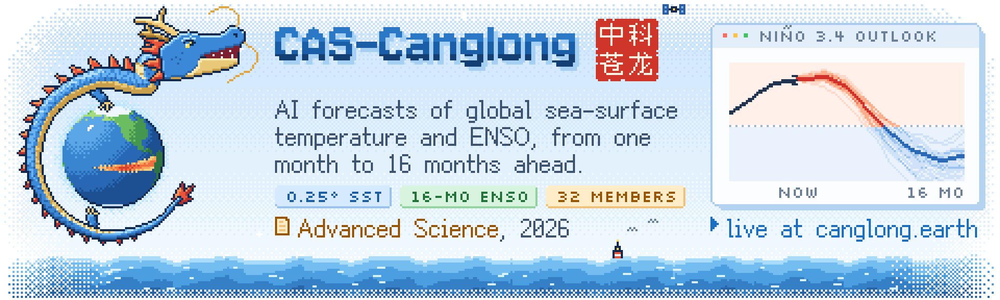
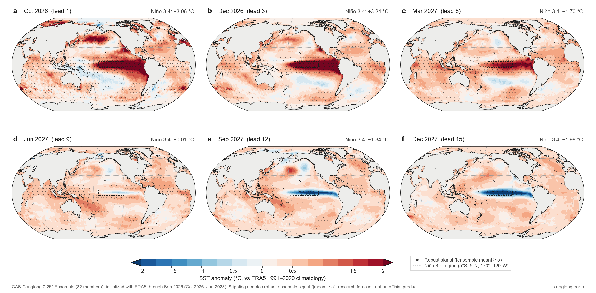
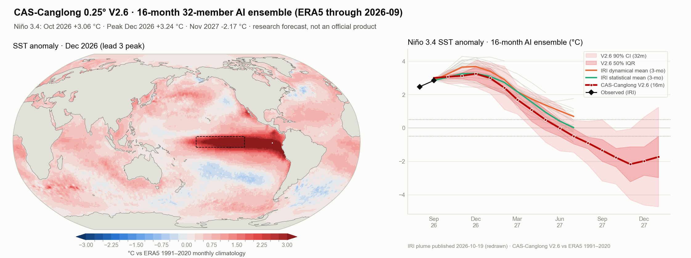
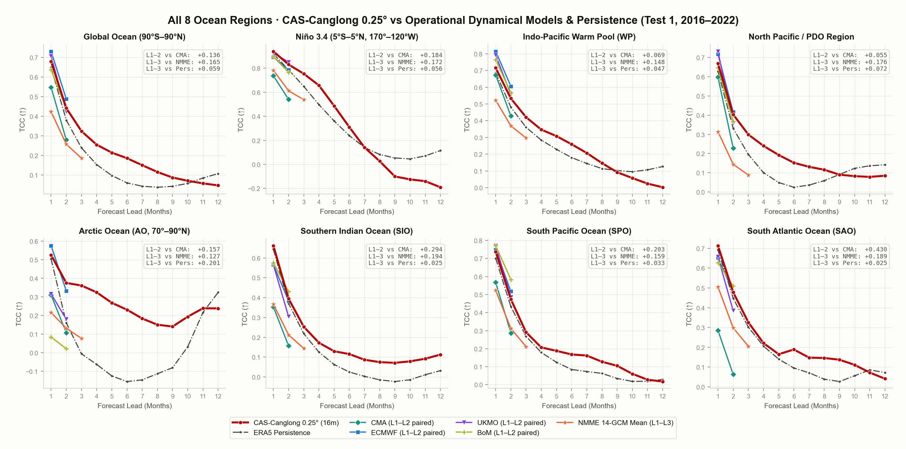
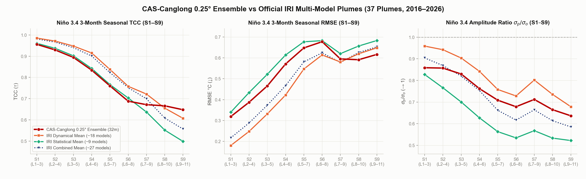
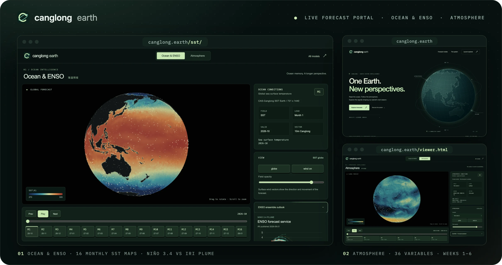

<!-- readme-visual-refresh:banner -->
<picture>
  <source media="(prefers-color-scheme: dark)" srcset="assets/readme/banner_dark.svg">
  
</picture>
<!-- /readme-visual-refresh:banner -->

<div align="center">

[](https://doi.org/10.1002/advs.78271)
[](https://arxiv.org/abs/2409.05369)
[](https://huggingface.co/spaces/LonghaoWang/CAS-Canglong)
[](https://huggingface.co/LonghaoWang/CAS-Canglong-SST)
[](https://canglong.earth)
[](https://doi.org/10.6084/m9.figshare.26779969)
[](https://github.com/GISWLH/WeatherAI/blob/main/docs/models/canglong.md)
[](LICENSE)
[](https://github.com/GISWLH/CAS-Canglong/stargazers)

**English** · [简体中文](README_zh.md)

</div>

CAS-Canglong is a 3-D Earth-specific transformer that learns the coupled ocean–atmosphere system from ERA5 and predicts
monthly global sea-surface temperature (SST) and ENSO. In our *Advanced Science* paper, CAS-Canglong improves 1–3-month
SST skill by **55.6 ± 14.1 % to 63.4 ± 15.5 %** over physics-based seasonal models across six key ocean regions.

This repository and [Hugging Face (`LonghaoWang/CAS-Canglong-SST`)](https://huggingface.co/LonghaoWang/CAS-Canglong-SST)
now provide the updated **CAS-Canglong 0.25°** and **CAS-Canglong 0.25° Ensemble** models — native **0.25° (`721 × 1440`)**
16-month global SST and **32-member ensemble** ENSO forecasts packaged in a single `.tar.gz` checkpoint (~273 MB), shown
live on the [Hugging Face Space](https://huggingface.co/spaces/LonghaoWang/CAS-Canglong) and
[canglong.earth](https://canglong.earth).

## 📢 News

- **2026-11-23** · 🚀 **[CAS-Canglong 0.25° & 0.25° Ensemble updated](https://huggingface.co/LonghaoWang/CAS-Canglong-SST)**:
  updated native 0.25° 16-month global SST and 32-member ensemble forecast model in a single `.tar.gz` checkpoint. In
  strictly out-of-sample evaluation, it sweeps **NMME 44/44 (100%)** and **CMA 16/16** across all 8 paper regions,
  beats **IRI Statistical Mean 9/9** (RMSE & amplitude), and outperforms **IRI Dynamical Mean** at S8–S9
  (`TCC 0.666 / 0.648`). Live now on the
  [Hugging Face Space](https://huggingface.co/spaces/LonghaoWang/CAS-Canglong) and
  [WeatherAI](https://github.com/GISWLH/WeatherAI/blob/main/docs/models/canglong.md).
- **2026-10** · The six-week atmospheric run can be read with [WeatherPre](https://github.com/GISWLH/WeatherPre):
  `wp.forecast("canglong", "t2m", "6w")`.
- **2026-10** · The figshare paper checkpoint runs bit-exact in [WeatherAI](https://github.com/GISWLH/WeatherAI) (`max |Δ| = 0.0`).
- **2026-10-15** · Paper published in *Advanced Science*:
  [doi:10.1002/advs.78271](https://doi.org/10.1002/advs.78271) (open access, CC BY 4.0).
- **2024-11** · Original paper weights and normalised data released on
  [figshare](https://doi.org/10.6084/m9.figshare.26779969). **2024-09** · Preprint
  [arXiv:2409.05369](https://arxiv.org/abs/2409.05369).

## 🌊 Latest forecast (CAS-Canglong 0.25° Ensemble · 16 months)

<picture>
  <source media="(prefers-color-scheme: dark)" srcset="assets/readme/global_outlook_dark.png">
  
</picture>

Initialised with ERA5 monthly means through **September 2026** (observed Niño 3.4 = **+2.99 °C**, ERA5 1991–2020 base),
**CAS-Canglong 0.25° Ensemble** (32 members) forecasts **+3.06 °C** in October 2026 (lead 1), **+3.12 °C** in November,
peaking at **+3.24 °C** in December 2026 (`90% CI [+2.43, +4.05 °C]`), transitioning through neutral in May–June 2027,
and developing La Niña conditions reaching **−2.17 °C** in November 2027 (lead 14) — closely tracking the
[IRI dynamical plume](https://iri.columbia.edu/our-expertise/climate/forecasts/enso/current/) while extending 16 months
ahead (`Oct 2026 – Jan 2028`).



The [Space](https://huggingface.co/spaces/LonghaoWang/CAS-Canglong) provides interactive maps for all 16 forecast months
(SST, SST anomaly, top-quintile probability, and 32-member ensemble spread `σ`), 12 regional outlooks, and NetCDF/CSV
downloads. Regenerate both figures without a GPU: `python scripts/plot_global_outlook.py` and
`python scripts/plot_latest_forecast.py`.

## 📊 Out-of-Sample Verification

Trained on **1959-01 – 2009-08** and validated on **2009-09 – 2016-04**; both **Test 1 (`2016-05 – 2022-12`, 80 months)**
and **Blind Test 2 (`2023-01 – 2026-09`, 45 months)** are strictly out-of-sample.

### 1. All 8 Paper Regions vs External Operational Dynamical Models

| Benchmark (`2016–2022` paired, out-of-sample) | 0.25° Global TCC | Ref Global TCC | 0.25° Niño 3.4 TCC | Ref Niño 3.4 TCC | 0.25° Global ARMSE (°C) | Ref Global ARMSE (°C) | Head-to-Head |
|---|---:|---:|---:|---:|---:|---:|---|
| **vs CMA** (Lead 1 / Lead 2) | **0.676 / 0.424** | 0.548 / 0.279 | **0.855 / 0.792** | 0.737 / 0.541 | **0.373 / 0.463** | 0.511 / 0.679 | **16 / 16 sweep** (all 8 regions) |
| **vs ECMWF** (Lead 1 / Lead 2) | 0.676 / 0.424 | **0.732 / 0.488** | 0.855 / **0.792** | **0.893** / 0.786 | **0.373 / 0.463** | 0.395 / 0.529 | Beats ECMWF in **L2 Niño 3.4**, **L1–L2 Global ARMSE**, SIO, SAO |
| **vs UKMO** (Lead 1 / Lead 2) | 0.676 / 0.424 | **0.707 / 0.425** | 0.855 / 0.792 | **0.925 / 0.851** | **0.373 / 0.463** | 0.645 / 0.787 | Beats UKMO in **L1–L2 ARMSE** & PDO/AO/SIO/SAO |
| **vs BoM** (Lead 1 / Lead 2) | **0.677** / 0.426 | 0.637 / **0.438** | 0.859 / **0.797** | **0.896** / 0.766 | **0.371 / 0.460** | 0.827 / 0.882 | Beats BoM in **L1 Global, L2 Niño 3.4, L1–L2 ARMSE** |
| **vs NMME** (`44` paired slots, L1–L3) | **44 / 44** | — | **44 / 44** | — | **44 / 44** | — | **100% Grand Slam** (CanSIPS-IC4, CESM1, GEM-NEMO, NASA-GEOSS2S, ...) |



### 2. Long-Range 16-Month Skill & 37 Official IRI Plumes (`2016–2026`, S1–S9)

- **All 8 Paper Regions (`Test 1 2016–2022` L1–3 mean TCC):** Global **0.4822** (Pers 0.4229), Niño 3.4 **0.8413** (Pers 0.7848),
  WP **0.5564**, PDO **0.4572**, AO **0.4201**, SIO **0.4365**, SPO **0.5010**, SAO **0.5061**.
- **Blind Future (`Test 2 2023–2026`):** L1–3 Global **0.5040** & Niño 3.4 **0.9429**; L1–6 Niño 3.4 **0.8760**;
  **L7–16 Niño 3.4 0.6728** (vs Persistence −0.3515) and L7–16 Global **0.1874** (vs Persistence −0.0659).
- **37 Official IRI Plumes (`S1..S9`, 3-month seasonal means):**
  - Sweeps **IRI Statistical Mean 9 / 9** on both **RMSE** (`0.319..0.616 °C` vs `0.340..0.683 °C`) and **Amplitude Ratio** (`0.859..0.636` vs `0.827..0.522`).
  - Outperforms **IRI Dynamical Mean** (~18 coupled GCMs) at **S8–S9** in both TCC (**0.666 vs 0.656** at S8; **0.648 vs 0.608** at S9) and RMSE (**0.591 vs 0.619 °C**; **0.616 vs 0.648 °C**).
  - **0.25° Ensemble (32 members):** Lead 1–16 Niño 3.4 Spread–Skill Ratio `0.85–1.05`, CRPS `0.179 °C` (S1) → `0.366 °C` (S6).



## 🧭 Forecast products

| Product | Forecast range | Grid | Access |
|---|---|---|---|
| **CAS-Canglong 0.25°** | monthly deterministic global SST, 1–16 months ahead | Native **0.25°** (`721 × 1440`) | [HF Weights (`.tar.gz`)](https://huggingface.co/LonghaoWang/CAS-Canglong-SST) · [WeatherAI](https://github.com/GISWLH/WeatherAI/blob/main/docs/models/canglong.md) |
| **CAS-Canglong 0.25° Ensemble** | 32-member monthly SST mean, spread, 90% CI & quintile probabilities, 1–16 months ahead | Native **0.25°** (`721 × 1440`) | [Space](https://huggingface.co/spaces/LonghaoWang/CAS-Canglong) · [HF Weights (`.tar.gz`)](https://huggingface.co/LonghaoWang/CAS-Canglong-SST) · [WeatherAI](https://github.com/GISWLH/WeatherAI/blob/main/docs/models/canglong.md) |
| **3-D Interactive Portal** | monthly 16-month SST & Niño 3.4 globe + 6-week atmosphere | 0.25° / 1° | [canglong.earth](https://canglong.earth/sst/) |
| **Atmospheric outlook** | weekly means of 36 variables, weeks 1–6 | 0.25°, published at 1° | [canglong.earth](https://canglong.earth/viewer.html) · [WeatherPre](https://github.com/GISWLH/WeatherPre) (`canglong`) |
| **Original *Advanced Science* Paper Model** | monthly SST, 1–3 months ahead | 0.25° | [`notebook/`](notebook/) · [figshare](https://doi.org/10.6084/m9.figshare.26779969) · [WeatherAI](https://github.com/GISWLH/WeatherAI/blob/main/docs/models/canglong.md) |

## 🚀 Quick start

**1 · Latest 16-month forecast as data (no GPU, no ERA5)**

```python
import xarray as xr
from huggingface_hub import hf_hub_download

path = hf_hub_download("LonghaoWang/CAS-Canglong", "data/canglong_sst_v26_init202609.nc", repo_type="space")
ds = xr.open_dataset(path)
print(ds.nino34_9120.to_series().round(2))     # 16-month Niño 3.4 ensemble mean (°C, 1991–2020 base)
print(ds.prob_elnino.to_series().round(2))     # 32-member El Niño probability (Oct 2026 – Jan 2028)
```

**2 · Run CAS-Canglong 0.25° & 0.25° Ensemble locally (single-file 273 MB `.tar.gz`)**

Works directly via [`canglong/v2.py`](canglong/v2.py) or
[WeatherAI](https://github.com/GISWLH/WeatherAI/blob/main/docs/models/canglong.md):

```python
import torch
from huggingface_hub import hf_hub_download
from canglong.v2 import load_canglong_v2  # or: from weatherai.models.canglong import load_official

ckpt = hf_hub_download("LonghaoWang/CAS-Canglong-SST", "canglong025_v26_16m_ens.tar.gz")
model = load_canglong_v2(ckpt, map_location="cuda").eval()

# x: (1, 8, 16, 721, 1440) normalized ERA5 monthly window (exact same format as normalized_data.pt)
with torch.no_grad(), torch.autocast("cuda", dtype=torch.bfloat16):
    # CAS-Canglong 0.25° deterministic 16-month forecast
    sst_det = model(x, out_leads=16)[0, 0] * 11.627 + 286.79  # (16, 721, 1440) SST [K]

    # CAS-Canglong 0.25° Ensemble (32 members, 16 months)
    ens = model.forecast_ensemble(
        x, n_members=32, out_leads=16, seed=42, batch_size=1, output_device="cpu",
    )[0, :, 0] * 11.627 + 286.79                              # (32, 16, 721, 1440) SST [K]
```

Or run the CLI inference script directly:

```bash
python scripts/infer_v26.py --checkpoint canglong025_v26_16m_ens.tar.gz --smoke-test
python scripts/infer_v26.py --checkpoint canglong025_v26_16m_ens.tar.gz --input my_era5_16m.pt --members 32 --leads 16 --out forecast_025_ens.npz
```

**3 · Run the original *Advanced Science* paper model (1–3 months)**

```bash
pip install git+https://github.com/GISWLH/WeatherAI.git
# canglong3_0005_600ep_base.tar, normalized_data.pt and ocean_mask.npy from https://doi.org/10.6084/m9.figshare.26779969
```

```python
import torch
from weatherai.models.canglong import load_official

model = load_official("canglong3_0005_600ep_base.tar").eval()
data = torch.load("normalized_data.pt", mmap=True)
x = data[141:157].permute(1, 0, 2, 3)[None].float()
with torch.no_grad():
    sst = model(x)[0, 0] * 11.627 + 286.79
```

**4 · Six-week atmospheric outlook**

```python
import weatherpre as wp  # pip install "weatherpre @ git+https://github.com/GISWLH/WeatherPre"
u = wp.forecast("canglong", ["t2m", "tp", "z500", "msl"], "6w")
```

## 📁 Repository

| Path | Content |
|---|---|
| [`canglong/`](canglong) | Standalone **CAS-Canglong 0.25°** & **0.25° Ensemble** PyTorch implementation (`v2.py` + `load_canglong_v2`) |
| [`scripts/`](scripts) | `infer_v26.py` (0.25° deterministic & 32-member ensemble CLI), `plot_global_outlook.py`, `plot_latest_forecast.py` |
| [`hf_space/`](hf_space) | Source of the live [Hugging Face Space](https://huggingface.co/spaces/LonghaoWang/CAS-Canglong) (Gradio app, asset builder, deploy script) |
| [`notebook/`](notebook) | Original *Advanced Science* paper notebooks ([model.ipynb](notebook/model.ipynb), [Infer.ipynb](notebook/Infer.ipynb), [Figure.ipynb](notebook/Figure.ipynb)) |
| [`utils/`](utils) | Original 3-D patch embedding, recovery, Earth-specific position index, shifted-window helpers |
| [`data/`](data) | Evaluation tables behind the paper figures and sample GeoTIFFs |

## 📚 Papers

- Wang, L., Zhang, X., Leung, L. R., Chiew, F. H. S., AghaKouchak, A., Ying, K., & Zhang, Y. (2026). Improved skills for
  predicting sub-seasonal to seasonal global sea surface temperature. *Advanced Science*, e78271.
  [doi:10.1002/advs.78271](https://doi.org/10.1002/advs.78271)
- Wang, L., Zhang, X., Leung, L. R., Chiew, F. H. S., AghaKouchak, A., Ying, K., & Zhang, Y. (2024). CAS-Canglong: A
  skillful 3D Transformer model for sub-seasonal to seasonal global sea surface temperature prediction. *arXiv*
  [2409.05369](https://arxiv.org/abs/2409.05369).
- Wang, L., Zhang, Y., & Zhang, X. (2024). Skilful prediction of mid-term sea surface temperature using 3D
  self-attention-based neural network. *EGU General Assembly 2024*.
  [doi:10.5194/egusphere-egu24-9446](https://doi.org/10.5194/egusphere-egu24-9446)

## 📖 Citation

```bibtex
@article{wang2026canglong,
  title   = {Improved Skills for Predicting Sub-Seasonal to Seasonal Global Sea Surface Temperature},
  author  = {Wang, Longhao and Zhang, Xuanze and Leung, L. Ruby and Chiew, Francis H. S. and
             AghaKouchak, Amir and Ying, Kairan and Zhang, Yongqiang},
  journal = {Advanced Science},
  year    = {2026},
  pages   = {e78271},
  doi     = {10.1002/advs.78271}
}
```

## 🌐 Related

- [canglong.earth](https://canglong.earth) — interactive 3-D globe portal for ocean, ENSO, and 6-week atmosphere outlooks.
- [WeatherAI](https://github.com/GISWLH/WeatherAI) — readable PyTorch ports of 20+ weather and climate AI models (CAS-Canglong included).
- [WeatherPre](https://github.com/GISWLH/WeatherPre) — one-line forecasts and scoring across 29 AI and NWP models.

## License

Code: [MIT](LICENSE). Pangu-style blocks follow [WeatherLearn](https://github.com/lizhuoq/WeatherLearn) (MIT).
ERA5 is © ECMWF / Copernicus Climate Change Service. Forecasts are research products, not official warnings.

[](https://star-history.com/#GISWLH/CAS-Canglong&Date)

## 🌍 See it live on canglong.earth

<a href="https://canglong.earth"></a>

[**canglong.earth**](https://canglong.earth) publishes interactive 3-D globes for the CAS-Canglong ocean, ENSO, and
6-week atmospheric forecasts.

<!-- readme-visual-refresh:artwork-source -->
<sub>[Editable artwork source · logo, whiteboard banner and portal showcase](assets/readme/src/)</sub>
<!-- /readme-visual-refresh:artwork-source -->
