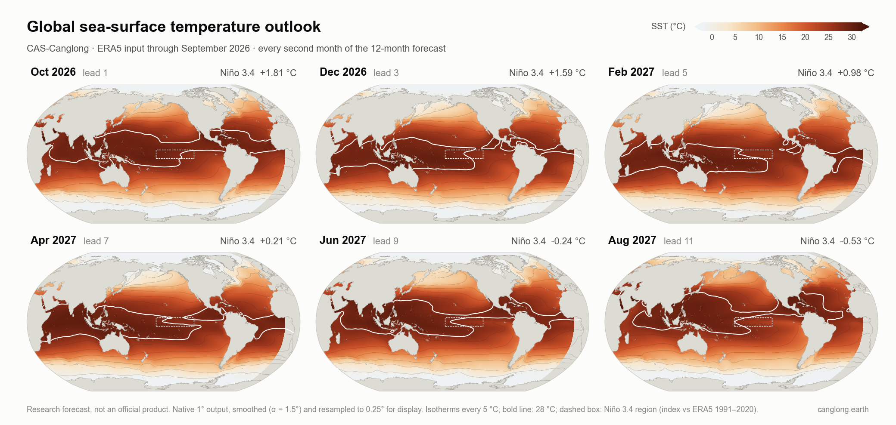
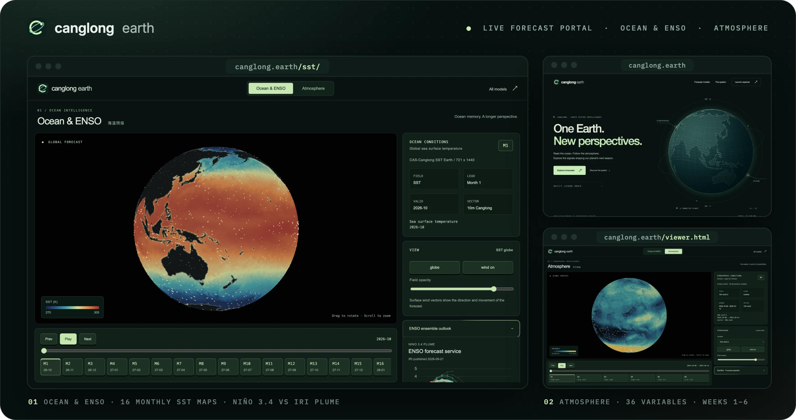

<!-- readme-visual-refresh:banner -->
<picture>
  <source media="(prefers-color-scheme: dark)" srcset="assets/readme/banner_dark.svg">
  
</picture>
<!-- /readme-visual-refresh:banner -->

<div align="center">

[](https://doi.org/10.1002/advs.78271)
[](https://arxiv.org/abs/2409.05369)
[](https://huggingface.co/spaces/LonghaoWang/CAS-Canglong)
[](https://huggingface.co/LonghaoWang/CAS-Canglong-SST)
[](https://huggingface.co/datasets/LonghaoWang/SST-Hindcast-2016-2022-1deg-lead1-12)
[](https://canglong.earth)
[](https://doi.org/10.6084/m9.figshare.26779969)
[](https://github.com/GISWLH/WeatherAI/blob/main/docs/models/canglong.md)
[](LICENSE)

[English](README.md) · **简体中文**

</div>

CAS-Canglong 是一个三维地球特定 Transformer，从 ERA5 中学习海洋—大气耦合系统，预测全球逐月海表温度（SST）。
*Advanced Science* 论文显示，在对陆地次季节—季节（S2S）变率影响最大的六个海区，它将 1–3 个月 SST 预测技巧比基于物理的
季节预测模式提高 **55.6 ± 14.1 % 至 63.4 ± 15.5 %**。项目现已发布**12 个月概率海温与 ENSO 模型**（2026-10-25 版，
[权重见 Hugging Face](https://huggingface.co/LonghaoWang/CAS-Canglong-SST)），实时结果展示在
[Hugging Face Space](https://huggingface.co/spaces/LonghaoWang/CAS-Canglong)；[canglong.earth](https://canglong.earth)
继续提供**16 个月业务海温展望**和**6 周大气展望**。

## 📢 动态

- **2026-10-27** · 🧠 [12 个月海温模型发布](https://huggingface.co/LonghaoWang/CAS-Canglong-SST)：2026-10-25 版的冻结权重、
  校正状态与推理代码，附 2023–2026 年目标的时间外检验。[Space](https://huggingface.co/spaces/LonghaoWang/CAS-Canglong)
  已切换为该模型：2026 年 10 月至 2027 年 9 月的均值、离散度与五分位概率。
- **2026-10-26** · 🗂️ [回报数据集](https://huggingface.co/datasets/LonghaoWang/SST-Hindcast-2016-2022-1deg-lead1-12)：
  2016–2022 年每个目标月的观测海温与 1–12 个月时效回报（CC BY 4.0）。
- **2026-10** · 🤗 [实时预报 Space](https://huggingface.co/spaces/LonghaoWang/CAS-Canglong) 上线（当时展示 16 个月业务运行）：
  海温图、Niño 3.4 与 IRI 预测羽对比、分区展望与 NetCDF 下载。
- **2026-10** · 6 周大气预报可用 [WeatherPre](https://github.com/GISWLH/WeatherPre) 读取：
  `wp.forecast("canglong", "t2m", "6w")`。
- **2026-10** · figshare 权重可在 [WeatherAI](https://github.com/GISWLH/WeatherAI) 的原生 PyTorch 实现中运行；
  在公开数据上与本仓库 notebook 代码输出完全一致（max |Δ| = 0.0，RTX 4090）。
- **2026-10-15** · 论文发表于 *Advanced Science*：
  [doi:10.1002/advs.78271](https://doi.org/10.1002/advs.78271)（开放获取，CC BY 4.0）。
- **2024-11** · 权重与标准化训练数据发布于 [figshare](https://doi.org/10.6084/m9.figshare.26779969)；
  **2024-09** · 预印本 [arXiv:2409.05369](https://arxiv.org/abs/2409.05369)。

## 🌊 最新预报

<picture>
  <source media="(prefers-color-scheme: dark)" srcset="assets/readme/global_outlook_dark.png">
  
</picture>

以截至 **2026 年 9 月**的 ERA5 月平均场为初值（当月 Niño 3.4 为 **+2.99 °C**，ERA5，1991–2020 基准），2026-10-25 版模型
预报 2026 年 10 月为 **+1.81 °C**、2027 年 1 月 +1.25 °C，2027 年 4 月回到中性，7–9 月为 −0.4 至 −0.7 °C。这一衰减明显快于
10 月 19 日的 [IRI 预测羽](https://iri.columbia.edu/our-expertise/climate/forecasts/enso/current/)（动力模式平均 OND
+3.64 °C）和 canglong.earth 上仍在展示的上一版业务运行（10 月 +3.75 °C，1959–2016 基准）。四个冻结基础分支本身已出现
这种衰减，且下文时间外检验中 Niño 3.4 是该方法最弱的区域，解读 ENSO 展望时请谨慎。上图每隔 2 个月展示一次 12 个月预报；
图中为 1° 原生输出，平滑仅用于显示。


[Space](https://huggingface.co/spaces/LonghaoWang/CAS-Canglong) 还提供每个月的离散度、进入最暖五分位的概率、分区展望与数据文件。
这是科研预报，不是官方预报。无需 GPU 即可重新绘制两幅图：
`python scripts/plot_global_outlook.py` 与 `python scripts/plot_latest_forecast.py`。

### 2026-10-25 版模型表现如何？

发布权重的校正使用了截至 2026 年 9 月的目标，因此其全部历史分数（包括
[2016–2022 回报](https://huggingface.co/datasets/LonghaoWang/SST-Hindcast-2016-2022-1deg-lead1-12)）均为样本内结果。
为做时间外检验，同一方法仅用 2022 年前的目标重新拟合，再在 2023-01 至 2026-09 的目标上评分（1–12 个月时效平均、
全球海洋、2023 年 7 月至 2024 年 6 月共 12 个共同起报月）：

| 模型 | 空间 ACC | RMSE（°C） |
|---|---|---|
| CAS-Canglong 方法，拟合至 2022 年 | **0.735** | **0.667** |
| 冻结季节模型（校正前） | 0.700 | 0.755 |
| COLA-RSMAS-CESM1 · CCSM4 · CanSIPS-IC4（原始集合平均档案） | 0.331 · 0.229 · 0.216 | 1.53 · 1.51 · 1.23 |

校正在北极、北太平洋和南大西洋提升最明显；Niño 3.4 在所有时效上都不如未校正模型。方法设计曾参考 2022 年后的结果，
动力模式档案未做漂移订正，样本也较短，因此这是回溯性检验而非盲测。协议、审计与全部分数见
[模型仓库](https://huggingface.co/LonghaoWang/CAS-Canglong-SST/tree/main/evaluation/round6_temporal_holdout_20261026)。

## ✨ 亮点

- **端到端学习海洋记忆**：16 个月、8 个 ERA5 变量（SST、海平面气压、潜热通量、10 m 风、500/850 hPa 位势、
  净短波辐射），0.25° 网格，以三维 patch 嵌入并经地球特定窗口自注意力处理。
- **快**：4390 万参数的论文模型在 RTX 4090 上 0.8 秒完成一次 721 × 1440 全球预报，4 核 CPU 约 1 分钟；
  训练约 7 天（4 × A100 80 GB）。
- **公开可核查**：权重和数据在 figshare，notebook 代码在本仓库，WeatherAI 的独立 PyTorch 复现读取公开权重并给出相同结果。
- **业务运行**：每月 16 个月海温与 ENSO 展望、逐周大气展望，以及已公开权重的 12 个月概率模型和公开回报；所有产品都以数据而非仅图片形式发布。

## 🧭 预报产品

CAS-Canglong 面向次季节—季节预测应用，提供全球海洋与大气展望。

| 产品 | 预报范围 | 网格 | 获取方式 |
|---|---|---|---|
| **海温与 ENSO 模型（2026-10-25 版）** | 逐月 SST 均值、离散度与五分位概率，提前 1–12 个月 | 1° | [Space](https://huggingface.co/spaces/LonghaoWang/CAS-Canglong) · [权重](https://huggingface.co/LonghaoWang/CAS-Canglong-SST) · [回报](https://huggingface.co/datasets/LonghaoWang/SST-Hindcast-2016-2022-1deg-lead1-12) |
| **业务海温与 ENSO 展望** | 逐月 SST 与 Niño 3.4，提前 1–16 个月 | 1° + 学习型 0.25° 细化 | [canglong.earth](https://canglong.earth/sst/) |
| **大气展望** | 36 个变量的周平均，第 1–6 周 | 0.25°，以 1° 发布 | [canglong.earth](https://canglong.earth/viewer.html) 与 [WeatherPre](https://github.com/GISWLH/WeatherPre)，路由 `canglong` |

为支持科研复现，本仓库提供论文中提前 1–3 个月、0.25° 逐月 SST 预测的[代码](notebook/)，公开权重见
[figshare](https://doi.org/10.6084/m9.figshare.26779969)，也可使用
[WeatherAI 实现](https://github.com/GISWLH/WeatherAI/blob/main/docs/models/canglong.md)。2026-10-25 版 12 个月模型已在
[Hugging Face](https://huggingface.co/LonghaoWang/CAS-Canglong-SST) 发布权重、推理代码与 CPU 示例；canglong.earth 上
16 个月业务运行的权重尚未公开。

2026-10-25 版模型读取 1° 网格上 120 个月的 8 个 ERA5 变量。基于 1° CAS-Canglong 网络的四个冻结分支（网络/EOF 混合、
慢背景、海气联合、季节状态）组成季节模型，再以 10% 权重混入逐格点岭回归校正，并给出 Gaussian 离散度与校准后的五分位概率。
16 个月业务展望由 Swin 模型单次前向计算生成，其检查点筛选参考了历史 NWP 多模式平均和 IRI ENSO 预测羽；因此两种实时产品都
不是独立的技巧检验，已发表的预测技巧对应论文中评估的配置。大气预报未做漂移订正（高纬度随预报时效偏暖），
应将其视为模式输出而非订正后的距平。

## 🚀 快速开始

**1 · 直接获取最新预报数据（无需 GPU 和 ERA5）**

```python
import xarray as xr
from huggingface_hub import hf_hub_download

path = hf_hub_download("LonghaoWang/CAS-Canglong", "data/canglong_sst_round5_init202609.nc", repo_type="space")
ds = xr.open_dataset(path)            # sst、ssta / ssta_9120、sigma、sst_q10 / sst_q90、五分位概率（1°）
print(ds.nino34_9120.to_series().round(2))   # 1991–2020 基准的 Niño 3.4
```

Space 中的 `data/run.json` 给出当前文件名；`scripts/plot_latest_forecast.py` 会自动下载并绘图。

**2 · 运行 12 个月模型（CPU 示例，无需 ERA5）**

```python
from huggingface_hub import snapshot_download
pkg = snapshot_download("LonghaoWang/CAS-Canglong-SST", allow_patterns=["frozen_model_20261025_v1/*"])
```

```bash
cd <pkg>/frozen_model_20261025_v1        # Python 3.11、torch 2.6、xarray、netCDF4、scipy，见 requirements.txt
python -B run_frozen.py --verify-only     # 按 FROZEN_MANIFEST.json 校验全部文件
python -B run_frozen.py --prepared-input examples/input_only_202610.npz --output /tmp/forecast_202610.nc
```

示例用随包提供的分支预报复现 2026 年 10 月起报结果。从原始 ERA5 月数据完整推理（`--input`、`--as-of-month`、`--gpu-uuid`）
需要一块支持 BF16 的 NVIDIA GPU；输入格式见[模型卡](https://huggingface.co/LonghaoWang/CAS-Canglong-SST)。

**3 · 2016–2022 回报**

```python
hc = xr.open_dataset(hf_hub_download("LonghaoWang/SST-Hindcast-2016-2022-1deg-lead1-12",
                     "hindcast_2016_2022_v1/sst_hindcast_201601_202212_lead01_12.nc", repo_type="dataset"))
hc.lead3.sel(time="2020-12")               # obs 与 lead1 … lead12 均对应同一目标月
```

**4 · 用官方权重运行论文模型**

```bash
pip install git+https://github.com/GISWLH/WeatherAI.git
# 从 https://doi.org/10.6084/m9.figshare.26779969 下载 canglong3_0005_600ep_base.tar、normalized_data.pt、ocean_mask.npy
```

```python
import torch
from weatherai.models.canglong import load_official

model = load_official("canglong3_0005_600ep_base.tar").eval()   # 可信文件：完整模块的 torch.save
data = torch.load("normalized_data.pt", mmap=True)               # (160, 8, 721, 1440) 标准化 ERA5 月数据
x = data[141:157].permute(1, 0, 2, 3)[None].float()              # 16 个输入月 -> (1, 8, 16, 721, 1440)
with torch.no_grad():
    sst = model(x)[0, 0] * 11.627 + 286.79                       # 未来 3 个月 SST [K]，(3, 721, 1440)
```

原始训练与推理 notebook 见 [`notebook/`](notebook)：[model.ipynb](notebook/model.ipynb)、[Infer.ipynb](notebook/Infer.ipynb)，
运行环境为 Python 3.8、torch 2.1.0+cu118、timm 1.0.11、numpy 1.24.4。

**5 · 6 周大气展望**

```python
import weatherpre as wp
u = wp.forecast("canglong", ["t2m", "tp", "z500", "msl"], "6w")  # canglong.earth 最新一次运行的周平均场
```

## 📁 仓库结构

| 路径 | 内容 |
|---|---|
| [`notebook/`](notebook) | 模型定义与训练（[model.ipynb](notebook/model.ipynb)）、推理（[Infer.ipynb](notebook/Infer.ipynb)）、论文图（[Figure.ipynb](notebook/Figure.ipynb)）、实验（[cang.ipynb](notebook/cang.ipynb)） |
| [`utils/`](utils) | 三维 patch 嵌入、恢复、地球特定位置编码、移位窗口掩膜、填充与裁剪；绘图工具 |
| [`data/`](data) | 论文图对应的评估表（各模式分区、分时效技巧，IRI 预测羽对比）及两个示例 GeoTIFF |
| [`scripts/`](scripts) | `plot_global_outlook.py` 与 `plot_latest_forecast.py`：下载并绘制最新预报 |
| [`hf_space/`](hf_space) | Hugging Face Space 源码：应用、资产构建与部署脚本 |

## 📚 论文

- Wang, L., Zhang, X., Leung, L. R., Chiew, F. H. S., AghaKouchak, A., Ying, K., & Zhang, Y. (2026). Improved skills for
  predicting sub-seasonal to seasonal global sea surface temperature. *Advanced Science*, e78271.
  [doi:10.1002/advs.78271](https://doi.org/10.1002/advs.78271)
- Wang, L., Zhang, X., Leung, L. R., Chiew, F. H. S., AghaKouchak, A., Ying, K., & Zhang, Y. (2024). CAS-Canglong: A
  skillful 3D Transformer model for sub-seasonal to seasonal global sea surface temperature prediction. *arXiv*
  [2409.05369](https://arxiv.org/abs/2409.05369).
- Wang, L., Zhang, Y., & Zhang, X. (2024). Skilful prediction of mid-term sea surface temperature using 3D
  self-attention-based neural network. *EGU General Assembly 2024*.
  [doi:10.5194/egusphere-egu24-9446](https://doi.org/10.5194/egusphere-egu24-9446)

完整论文列表见 [giswlh.github.io](https://giswlh.github.io/#publications)。

## 📖 引用

```bibtex
@article{wang2026canglong,
  title   = {Improved Skills for Predicting Sub-Seasonal to Seasonal Global Sea Surface Temperature},
  author  = {Wang, Longhao and Zhang, Xuanze and Leung, L. Ruby and Chiew, Francis H. S. and
             AghaKouchak, Amir and Ying, Kairan and Zhang, Yongqiang},
  journal = {Advanced Science},
  year    = {2026},
  pages   = {e78271},
  doi     = {10.1002/advs.78271}
}
```

## 🌐 相关项目

- [canglong.earth](https://canglong.earth)：实时门户，含海洋与 ENSO 地球仪、6 周大气查看器。
- [WeatherAI](https://github.com/GISWLH/WeatherAI)：20 个天气与气候 AI 模型的可读 PyTorch 复现，含 CAS-Canglong。
- [WeatherPre](https://github.com/GISWLH/WeatherPre)：29 个 AI 与数值模式的一行预报与评分。

## 许可

代码：[MIT](LICENSE)。Pangu 风格模块参考 [WeatherLearn](https://github.com/lizhuoq/WeatherLearn)（MIT）。
ERA5 © ECMWF / Copernicus 气候变化服务。预报为科研产品，不是官方预警。

## 🌍 在 canglong.earth 查看实时预报

<a href="https://canglong.earth"></a>

[**canglong.earth**](https://canglong.earth) 是 CAS-Canglong 的可视化服务。每次运行的结果都以可旋转、缩放的三维地球仪
发布，可逐月或逐周播放。

| 页面 | 内容 | 链接 |
|---|---|---|
| **海洋与 ENSO** | 16 个预报月的 SST（721 × 1440 网格）、10 m 风矢量，以及 Niño 3.4 与 IRI 预测羽对比 | [canglong.earth/sst](https://canglong.earth/sst/) |
| **大气** | 36 个地面与高空变量的周平均，第 1–6 周 | [canglong.earth/viewer.html](https://canglong.earth/viewer.html) |
| **门户首页** | 两套预报模型与系统概览 | [canglong.earth](https://canglong.earth) |

<div align="center">

**[打开 canglong.earth →](https://canglong.earth)**

</div>

<!-- readme-visual-refresh:artwork-source -->
<sub>[可编辑的图形源文件 · 标志、白板风格横幅与门户展示图](assets/readme/src/)</sub>
<!-- /readme-visual-refresh:artwork-source -->
