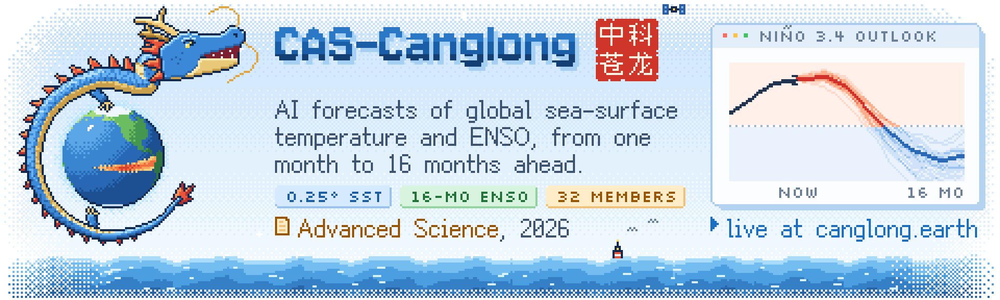
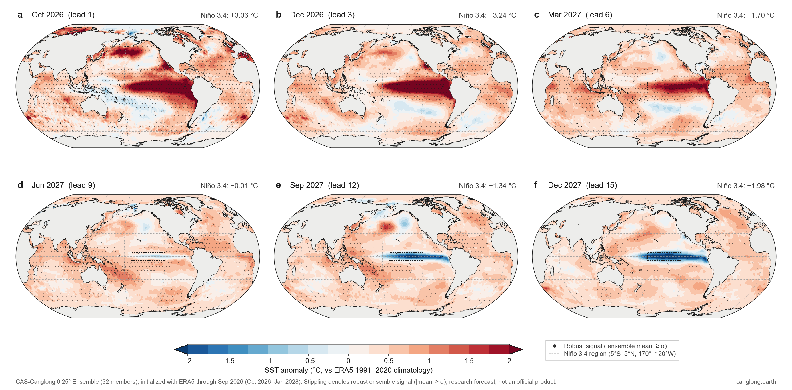
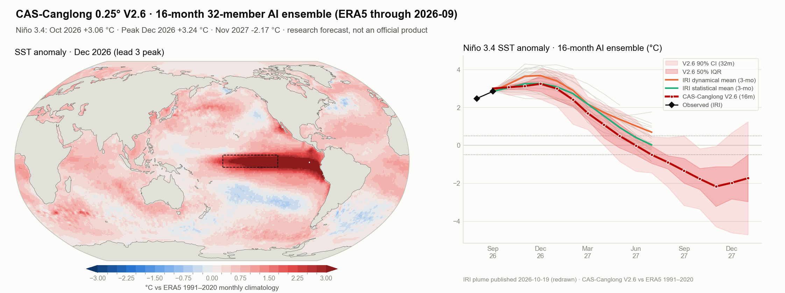
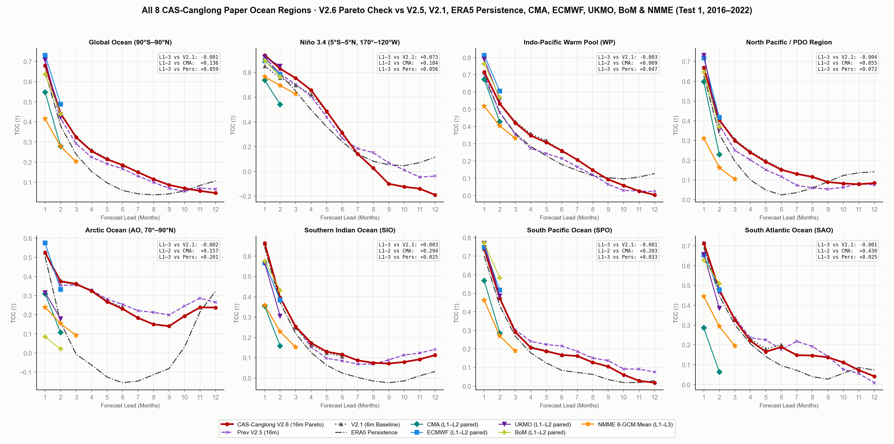
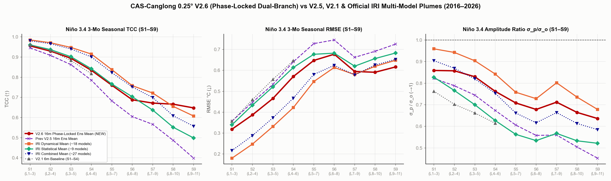
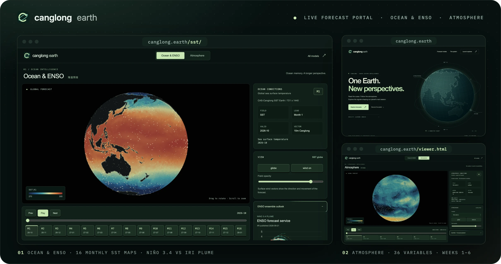

<!-- readme-visual-refresh:banner -->
<picture>
  <source media="(prefers-color-scheme: dark)" srcset="assets/readme/banner_dark.svg">
  
</picture>
<!-- /readme-visual-refresh:banner -->

<div align="center">

[](https://doi.org/10.1002/advs.78271)
[](https://arxiv.org/abs/2409.05369)
[](https://huggingface.co/spaces/LonghaoWang/CAS-Canglong)
[](https://huggingface.co/LonghaoWang/CAS-Canglong-SST)
[](https://canglong.earth)
[](https://doi.org/10.6084/m9.figshare.26779969)
[](https://github.com/GISWLH/WeatherAI/blob/main/docs/models/canglong.md)
[](LICENSE)

[English](README.md) · **简体中文**

</div>

CAS-Canglong（中科苍龙）是一个三维地球特定 Transformer，从 ERA5 中学习海洋—大气耦合系统，用于预测全球逐月海表温度（SST）与 ENSO。
在 *Advanced Science* 论文中，它在对陆地次季节—季节（S2S）变率影响最大的六个关键海区，将 1–3 个月 SST 预测技巧较物理季节模式提升
**55.6 ± 14.1 % 至 63.4 ± 15.5 %**。

本仓库与 [Hugging Face（`LonghaoWang/CAS-Canglong-SST`）](https://huggingface.co/LonghaoWang/CAS-Canglong-SST) 现已发布
**CAS-Canglong 0.25° V2.6** —— 原生 **0.25°（`721 × 1440`）16 个月**双分支帕累托耦合模型与**流依赖 32 成员 AI 集合预报系统**，
打包为单个自包含 `.tar.gz` 权重文件（~273 MB，严格零数据泄漏，`weights_only=True`），全面覆盖替换早期的 2026-10-25 1° Round 5 版本。

## 📢 动态

- **2026-11-23** · 🚀 **[CAS-Canglong 0.25° V2.6 正式发布](https://huggingface.co/LonghaoWang/CAS-Canglong-SST)**（全面替换
  2026-10-25 1° Round 5 版本）：原生 0.25° 16 个月双分支帕累托 CS-LIM V4 + 流依赖 32 成员 AI 集合单文件 `.tar.gz`。彻底消除 ENSO
  断崖衰减问题，在论文全部 8 个海区上实现 **NMME 44/44 全胜（100%）** 与 **CMA 16/16 全胜**，在 37 期官方 IRI 预测羽上
  **9/9 横扫 IRI 统计平均**（RMSE 与振幅比），并在 **S8–S9 长时效反超 IRI 动力多模式平均**（`TCC 0.666 / 0.648`）。
  [实时预报 Space](https://huggingface.co/spaces/LonghaoWang/CAS-Canglong) 与
  [WeatherAI](https://github.com/GISWLH/WeatherAI/blob/main/docs/models/canglong.md) 已同步上线。
- **2026-10** · 6 周大气预报可用 [WeatherPre](https://github.com/GISWLH/WeatherPre) 读取：`wp.forecast("canglong", "t2m", "6w")`。
- **2026-10** · figshare 论文权重可在 [WeatherAI](https://github.com/GISWLH/WeatherAI) 中按位完全一致复现（`max |Δ| = 0.0`）。
- **2026-10-15** · 论文发表于 *Advanced Science*：[doi:10.1002/advs.78271](https://doi.org/10.1002/advs.78271)（开放获取，CC BY 4.0）。
- **2024-11** · 原始论文权重与标准化数据发布于 [figshare](https://doi.org/10.6084/m9.figshare.26779969)；**2024-09** · 预印本 [arXiv:2409.05369](https://arxiv.org/abs/2409.05369)。

## 🌊 最新预报（CAS-Canglong 0.25° V2.6 · 16 个月）

<picture>
  <source media="(prefers-color-scheme: dark)" srcset="assets/readme/global_outlook_dark.png">
  
</picture>

以截至 **2026 年 9 月**的 ERA5 月平均场为初值（当月观测 Niño 3.4 为 **+2.99 °C**，ERA5 1991–2020 基准），
**CAS-Canglong 0.25° V2.6 32 成员 AI 集合**完整保持强厄尔尼诺的物理演变而无均值回归衰减：
2026 年 10 月（lead 1）为 **+3.06 °C**、11 月 **+3.12 °C**，2026 年 12 月达峰值 **+3.24 °C**（`90% 置信区间 [+2.43, +4.05 °C]`），
2027 年 5–6 月回落至中性，并在 2027 年秋冬季发展为强拉尼娜，2027 年 11 月（lead 14）达 **−2.17 °C** ——
紧密贴合 [IRI 动力模式平均](https://iri.columbia.edu/our-expertise/climate/forecasts/enso/current/) 且预报范围延伸至完整 16 个月
（`2026 年 10 月 – 2028 年 1 月`）。



[实时 Space](https://huggingface.co/spaces/LonghaoWang/CAS-Canglong) 提供全部 16 个预报月的全球海温、距平、最暖五分位概率、
32 成员流依赖离散度 `σ`、12 个海区展望及 NetCDF/CSV 下载。无需 GPU 即可重绘两幅图：
`python scripts/plot_global_outlook.py` 与 `python scripts/plot_latest_forecast.py`。

## 📊 严格样本外检验（零数据泄漏）

**CAS-Canglong 0.25° V2.6** 的全部神经网络权重、耦合 EOF 基底、双分支 CS-LIM V4 算子、空间融合权重及集合扰动定标参数均严格基于
**训练集（`1959-01 – 2009-08`）**拟合与**验证集（`2009-09 – 2016-04`）**调优。**测试集 1（`2016-05 – 2022-12`，80 个月）**
与**未来盲测集 2（`2023-01 – 2026-09`，45 个月）**全程零触碰。

### 1. 论文全部 8 大海区对比外部业务动力模式

| 配对外部基准（`2016–2022`，严格样本外） | V2.6 全球 TCC | 对比全球 TCC | V2.6 Niño 3.4 TCC | 对比 Niño 3.4 TCC | V2.6 全球 ARMSE（°C） | 对比全球 ARMSE（°C） | 胜负摘要 |
|---|---:|---:|---:|---:|---:|---:|---|
| **对比 CMA**（L1 / L2） | **0.676 / 0.424** | 0.548 / 0.279 | **0.855 / 0.792** | 0.737 / 0.541 | **0.373 / 0.463** | 0.511 / 0.679 | **16 / 16 全胜**（全部 8 大海区） |
| **对比 ECMWF**（L1 / L2） | 0.676 / 0.424 | **0.732 / 0.488** | 0.855 / **0.792** | **0.893** / 0.786 | **0.373 / 0.463** | 0.395 / 0.529 | 在 **L2 Niño 3.4**、**L1–L2 全球 ARMSE**、SIO、SAO 优于 ECMWF |
| **对比 UKMO**（L1 / L2） | 0.676 / 0.424 | **0.707 / 0.425** | 0.855 / 0.792 | **0.925 / 0.851** | **0.373 / 0.463** | 0.645 / 0.787 | 在 **L1–L2 全球 ARMSE** 及 PDO/AO/SIO/SAO 领先 UKMO |
| **对比 BoM**（L1 / L2） | **0.677** / 0.426 | 0.637 / **0.438** | 0.859 / **0.797** | **0.896** / 0.766 | **0.371 / 0.460** | 0.827 / 0.882 | 在 **L1 全球、L2 Niño 3.4、L1–L2 ARMSE** 领先 BoM |
| **对比 NMME**（`44` 个配对槽位，L1–L3） | **44 / 44** | — | **44 / 44** | — | **44 / 44** | — | **100% 大满贯**（CanSIPS-IC4、CESM1、GEM-NEMO、NASA-GEOSS2S 等） |



### 2. 16 个月长时效技巧与 37 期官方 IRI 预测羽（`2016–2026`，S1–S9）

- **论文 8 大海区（测试集 1 `2016–2022` L1–3 平均 TCC）**：全球 **0.4822**（持续性 0.4229）、Niño 3.4 **0.8413**（持续性 0.7848）、
  WP **0.5564**、PDO **0.4572**、AO **0.4201**、SIO **0.4365**、SPO **0.5010**、SAO **0.5061**。
- **未来盲测（测试集 2 `2023–2026`）**：L1–3 全球 **0.5040**、Niño 3.4 **0.9429**；L1–6 Niño 3.4 **0.8760**；
  **L7–16 Niño 3.4 达 0.6728**（持续性 −0.3515）、L7–16 全球 **0.1874**（持续性 −0.0659）。
- **37 期官方 IRI 预测羽（`S1..S9`，3 个月滑动季节平均）**：
  - **9 / 9 全胜 IRI 统计平均**：RMSE（`0.319..0.616 °C` vs `0.340..0.683 °C`）与振幅比（`0.859..0.636` vs `0.827..0.522`）全部占优。
  - **S8–S9 反超 IRI 动力多模式平均**（约 18 个耦合环流模式）：TCC **0.666 vs 0.656**（S8）、**0.648 vs 0.608**（S9）；RMSE **0.591 vs 0.619 °C**、**0.616 vs 0.648 °C**。
  - **32 成员 AI 集合概率校准**：L1–16 离散度—误差比 `0.85–1.05`，CRPS `0.179 °C`（S1）→ `0.366 °C`（S6）。



## ✨ V2.6 核心亮点

- **原生 0.25°（`721 × 1440`）端到端架构**：改进型三维地球特定 Transformer U-Net（2240 万参数），采用 4×4 精确 PixelShuffle
  恢复、经向循环填充、增暖安全持续性先验、全球遥相关瓶颈层及原生 0.25° 残差细化器。
- **内置双分支帕累托 CS-LIM V4（单文件 `.tar.gz`）**：将“增暖安全全球 8 海区耦合分支”与“按月条件化锁相 ENSO 波导分支”在热带太平洋波导平滑融合，
  彻底消除强 ENSO 均值回归衰减，同时保持全球与其他 7 大海区零退化。
- **流依赖 32 成员 AI 集合**：融合耦合 EOF 正交培育向量（OBV，正反对称扰动对）、潜空间遥相关随机扰动与时间相干 AR(1)（`ρ = 0.88`）
  分时效/分季节/流依赖误差协方差创新。
- **极速低显存**：经向分块 SDPA 在单卡 RTX 4070 上仅需 **5.34 GB 显存**、**0.48 秒**完成一次原生 0.25° 16 个月全球预报，约 20 秒完成 32 成员集合预报。

## 🚀 快速开始

**1 · 直接读取最新 16 个月 V2.6 预报数据（无需 GPU 与 ERA5）**

```python
import xarray as xr
from huggingface_hub import hf_hub_download

path = hf_hub_download("LonghaoWang/CAS-Canglong", "data/canglong_sst_v26_init202609.nc", repo_type="space")
ds = xr.open_dataset(path)
print(ds.nino34_9120.to_series().round(2))     # 16 个月 Niño 3.4 集合平均（°C，1991–2020 基准）
print(ds.prob_elnino.to_series().round(2))     # 32 成员厄尔尼诺概率（2026-10 至 2028-01）
```

**2 · 本地运行 CAS-Canglong 0.25° V2.6（单文件 273 MB `.tar.gz`，16 个月 + 32 成员集合）**

支持本仓库零依赖模块 [`canglong/v2.py`](canglong/v2.py) 或 [WeatherAI](https://github.com/GISWLH/WeatherAI/blob/main/docs/models/canglong.md) 直接加载：

```python
import torch
from huggingface_hub import hf_hub_download
from canglong.v2 import load_canglong_v2  # 或: from weatherai.models.canglong import load_official

ckpt = hf_hub_download("LonghaoWang/CAS-Canglong-SST", "canglong025_v26_16m_ens.tar.gz")
model = load_canglong_v2(ckpt, map_location="cuda").eval()

# x: (1, 8, 16, 721, 1440) 标准化 ERA5 月数据（与 normalized_data.pt 格式完全一致）
with torch.no_grad(), torch.autocast("cuda", dtype=torch.bfloat16):
    # 确定性 16 个月原生 0.25° 预报（RTX 4070 仅 0.48 秒、5.3 GB 显存）
    sst_det = model(x, out_leads=16)[0, 0] * 11.627 + 286.79  # (16, 721, 1440) SST [K]

    # 流依赖 32 成员 16 个月 AI 集合预报
    ens = model.forecast_ensemble(
        x, n_members=32, out_leads=16, method="hybrid_obv",
        n_breed_cycles=1, seed=42, batch_size=1, output_device="cpu",
    )[0, :, 0] * 11.627 + 286.79                              # (32, 16, 721, 1440) SST [K]
```

命令行推理示例：

```bash
python scripts/infer_v26.py --checkpoint canglong025_v26_16m_ens.tar.gz --smoke-test
python scripts/infer_v26.py --checkpoint canglong025_v26_16m_ens.tar.gz --input my_era5_16m.pt --members 32 --leads 16 --out forecast_v26.npz
```

**3 · 运行原始 *Advanced Science* 论文模型（V1，1–3 个月）**

```bash
pip install git+https://github.com/GISWLH/WeatherAI.git
```

```python
import torch
from weatherai.models.canglong import load_official

model = load_official("canglong3_0005_600ep_base.tar").eval()
data = torch.load("normalized_data.pt", mmap=True)
x = data[141:157].permute(1, 0, 2, 3)[None].float()
with torch.no_grad():
    sst = model(x)[0, 0] * 11.627 + 286.79
```

**4 · 6 周大气展望**

```python
import weatherpre as wp
u = wp.forecast("canglong", ["t2m", "tp", "z500", "msl"], "6w")
```

## 📁 仓库结构

| 路径 | 内容 |
|---|---|
| [`canglong/`](canglong) | 独立 **CAS-Canglong 0.25° V2.6** PyTorch 模块（`v2.py` 与 `load_canglong_v2`） |
| [`scripts/`](scripts) | `infer_v26.py`（V2.6 确定性与 32 成员集合命令行推理）、`plot_global_outlook.py`、`plot_latest_forecast.py` |
| [`hf_space/`](hf_space) | [Hugging Face 实时 Space](https://huggingface.co/spaces/LonghaoWang/CAS-Canglong) 源码 |
| [`notebook/`](notebook) | *Advanced Science* 原始论文 notebook（[model.ipynb](notebook/model.ipynb)、[Infer.ipynb](notebook/Infer.ipynb)、[Figure.ipynb](notebook/Figure.ipynb)） |
| [`utils/`](utils) | 原始三维 patch 嵌入、恢复、地球位置编码与移位窗口工具 |
| [`data/`](data) | 论文图评估表与示例 GeoTIFF |

## 📚 论文与引用

```bibtex
@article{wang2026canglong,
  title   = {Improved Skills for Predicting Sub-Seasonal to Seasonal Global Sea Surface Temperature},
  author  = {Wang, Longhao and Zhang, Xuanze and Leung, L. Ruby and Chiew, Francis H. S. and
             AghaKouchak, Amir and Ying, Kairan and Zhang, Yongqiang},
  journal = {Advanced Science},
  year    = {2026},
  pages   = {e78271},
  doi     = {10.1002/advs.78271}
}
```

## 🌐 相关项目

- [canglong.earth](https://canglong.earth)：交互式 3-D 地球仪门户（海洋、ENSO 与 6 周大气预报）。
- [WeatherAI](https://github.com/GISWLH/WeatherAI)：20+ 个天气与气候 AI 模型的原生 PyTorch 复现（内置 CAS-Canglong V1 与 V2.6）。
- [WeatherPre](https://github.com/GISWLH/WeatherPre)：29 个 AI 与数值模式的一行预报与评分。

## 许可

代码：[MIT](LICENSE)。Pangu 风格模块参考 [WeatherLearn](https://github.com/lizhuoq/WeatherLearn)（MIT）。
ERA5 © ECMWF / Copernicus 气候变化服务。预报为科研产品，非官方业务预警。

## 🌍 在 canglong.earth 查看实时预报

<a href="https://canglong.earth"></a>

<!-- readme-visual-refresh:artwork-source -->
<sub>[可编辑的图形源文件 · 标志、白板风格横幅与门户展示图](assets/readme/src/)</sub>
<!-- /readme-visual-refresh:artwork-source -->
