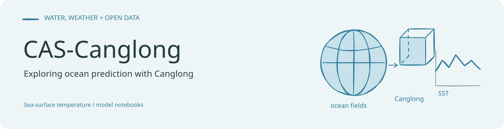
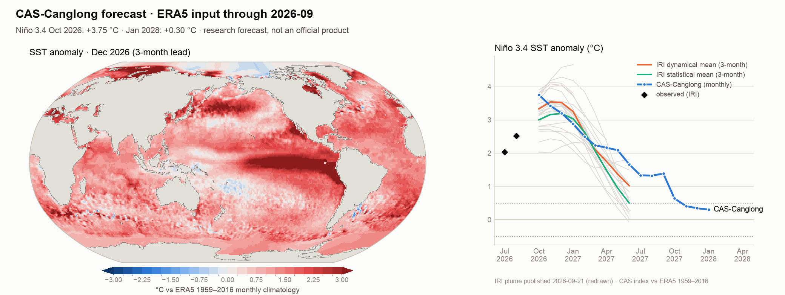

<!-- readme-visual-refresh:banner -->

<!-- /readme-visual-refresh:banner -->

<div align="center">

# 🐉 CAS-Canglong（苍龙）

**全球海表温度与 ENSO 的 AI 预报：从 1 个月到一年以上**

[](https://doi.org/10.1002/advs.78271)
[](https://arxiv.org/abs/2409.05369)
[](https://huggingface.co/spaces/LonghaoWang/CAS-Canglong)
[](https://canglong.earth)
[](https://doi.org/10.6084/m9.figshare.26779969)
[](https://github.com/GISWLH/WeatherAI/blob/main/docs/models/canglong.md)
[](LICENSE)

[English](README.md) · **简体中文**

</div>

CAS-Canglong 是一个三维地球特定 Transformer，从 ERA5 中学习海洋—大气耦合系统，预测全球逐月海表温度（SST）。
*Advanced Science* 论文显示，在对陆地次季节—季节（S2S）变率影响最大的六个海区，它将 1–3 个月 SST 预测技巧比基于物理的
季节预测模式提高 **55.6 ± 14.1 % 至 63.4 ± 15.5 %**。同一模型家族现已按月业务运行：**16 个月海温与 ENSO 展望**和
**6 周大气展望**，发布在 [canglong.earth](https://canglong.earth) 和
[Hugging Face Space](https://huggingface.co/spaces/LonghaoWang/CAS-Canglong)。

## 📢 动态

- **2026-10** · 🤗 [实时预报 Space](https://huggingface.co/spaces/LonghaoWang/CAS-Canglong)：16 个月海温图、
  Niño 3.4 与 IRI 预测羽对比、分区展望与 NetCDF 下载。
- **2026-10** · 6 周大气预报可用 [WeatherPre](https://github.com/GISWLH/WeatherPre) 读取：
  `wp.forecast("canglong", "t2m", "6w")`。
- **2026-10** · figshare 权重可在 [WeatherAI](https://github.com/GISWLH/WeatherAI) 的原生 PyTorch 实现中运行；
  在公开数据上与本仓库 notebook 代码输出完全一致（max |Δ| = 0.0，RTX 4090）。
- **2026-10-15** · 论文发表于 *Advanced Science*：
  [doi:10.1002/advs.78271](https://doi.org/10.1002/advs.78271)（开放获取，CC BY 4.0）。
- **2024-11** · 权重与标准化训练数据发布于 [figshare](https://doi.org/10.6084/m9.figshare.26779969)；
  **2024-09** · 预印本 [arXiv:2409.05369](https://arxiv.org/abs/2409.05369)。

## 🌊 最新预报



以截至 **2026 年 9 月**的 ERA5 月平均场为初值，预报 2026 年 10 月 Niño 3.4 距平为 **+3.75 °C**，2027 年 1 月回落至
+2.9 °C，并持续高于 +0.5 °C 至 2027 年 10 月。这是一次确定性科研预报，不是官方预报；解读方法和局限见
[Space](https://huggingface.co/spaces/LonghaoWang/CAS-Canglong)。无需 GPU 即可重新绘制：
`python scripts/plot_latest_forecast.py`。

## ✨ 亮点

- **端到端学习海洋记忆**：16 个月、8 个 ERA5 变量（SST、海平面气压、潜热通量、10 m 风、500/850 hPa 位势、
  净短波辐射），0.25° 网格，以三维 patch 嵌入并经地球特定窗口自注意力处理。
- **快**：4390 万参数的论文模型在 RTX 4090 上 0.8 秒完成一次 721 × 1440 全球预报，4 核 CPU 约 1 分钟；
  训练约 7 天（4 × A100 80 GB）。
- **公开可核查**：权重和数据在 figshare，notebook 代码在本仓库，WeatherAI 的独立 PyTorch 复现读取公开权重并给出相同结果。
- **业务运行**：每月 16 个月海温与 ENSO 展望，加上逐周大气展望；所有产品都以数据而非仅图片形式发布。

## 🧭 模型家族

| 模型 | 预报内容 | 网格 | 获取方式 |
|---|---|---|---|
| **CAS-Canglong**（论文） | 逐月 SST，提前 1–3 个月 | 0.25° | 本仓库 `notebook/`，权重见 [figshare](https://doi.org/10.6084/m9.figshare.26779969)，[WeatherAI 复现](https://github.com/GISWLH/WeatherAI/blob/main/docs/models/canglong.md) |
| **CAS-Canglong 业务海温模型** | 逐月 SST 与 Niño 3.4，提前 1–16 个月 | 1° + 学习型 0.25° 细化 | 预报见 [canglong.earth](https://canglong.earth/sst/) 与 [Space](https://huggingface.co/spaces/LonghaoWang/CAS-Canglong)；权重未公开 |
| **CAS-Canglong 大气 V3.5** | 36 个变量的周平均，第 1–6 周 | 0.25°，以 1° 发布 | 预报见 [canglong.earth](https://canglong.earth/viewer.html)，[WeatherPre](https://github.com/GISWLH/WeatherPre) 路由 `canglong`；权重未公开 |

业务海温模型是单次前向即输出全部 16 个月的 Swin Transformer。其检查点筛选参考了历史 NWP 多模式平均和当期 IRI ENSO
预测羽，因此实时预报不是独立的技巧检验；论文中的技巧指论文模型。大气预报未做漂移订正（高纬度随预报时效偏暖），
应将其视为模式输出而非订正后的距平。

## 🚀 快速开始

**1 · 直接获取最新预报数据（无需 GPU 和 ERA5）**

```python
import xarray as xr
from huggingface_hub import hf_hub_download

path = hf_hub_download("LonghaoWang/CAS-Canglong", "data/canglong_sst_init202609.nc", repo_type="space")
ds = xr.open_dataset(path)            # ssta / sst（1°）、sst_025（0.25°）、nino34、观测初值月
print(ds.nino34.to_series().round(2))
```

Space 中的 `data/run.json` 给出当前文件名；`scripts/plot_latest_forecast.py` 会自动下载并绘图。

**2 · 用官方权重运行论文模型**

```bash
pip install git+https://github.com/GISWLH/WeatherAI.git
# 从 https://doi.org/10.6084/m9.figshare.26779969 下载 canglong3_0005_600ep_base.tar、normalized_data.pt、ocean_mask.npy
```

```python
import torch
from weatherai.models.canglong import load_official

model = load_official("canglong3_0005_600ep_base.tar").eval()   # 可信文件：完整模块的 torch.save
data = torch.load("normalized_data.pt", mmap=True)               # (160, 8, 721, 1440) 标准化 ERA5 月数据
x = data[141:157].permute(1, 0, 2, 3)[None].float()              # 16 个输入月 -> (1, 8, 16, 721, 1440)
with torch.no_grad():
    sst = model(x)[0, 0] * 11.627 + 286.79                       # 未来 3 个月 SST [K]，(3, 721, 1440)
```

原始训练与推理 notebook 见 [`notebook/`](notebook)：[model.ipynb](notebook/model.ipynb)、[Infer.ipynb](notebook/Infer.ipynb)，
运行环境为 Python 3.8、torch 2.1.0+cu118、timm 1.0.11、numpy 1.24.4。

**3 · 6 周大气展望**

```python
import weatherpre as wp
u = wp.forecast("canglong", ["t2m", "tp", "z500", "msl"], "6w")  # canglong.earth 最新一次运行的周平均场
```

## 📁 仓库结构

| 路径 | 内容 |
|---|---|
| [`notebook/`](notebook) | 模型定义与训练（[model.ipynb](notebook/model.ipynb)）、推理（[Infer.ipynb](notebook/Infer.ipynb)）、论文图（[Figure.ipynb](notebook/Figure.ipynb)）、实验（[cang.ipynb](notebook/cang.ipynb)） |
| [`utils/`](utils) | 三维 patch 嵌入、恢复、地球特定位置编码、移位窗口掩膜、填充与裁剪；绘图工具 |
| [`data/`](data) | 论文图对应的评估表（各模式分区、分时效技巧，IRI 预测羽对比）及两个示例 GeoTIFF |
| [`scripts/`](scripts) | `plot_latest_forecast.py`：下载并绘制最新预报 |
| [`hf_space/`](hf_space) | Hugging Face Space 源码：应用、资产构建与部署脚本 |

## 📚 论文

- Wang, L., Zhang, X., Leung, L. R., Chiew, F. H. S., AghaKouchak, A., Ying, K., & Zhang, Y. (2026). Improved skills for
  predicting sub-seasonal to seasonal global sea surface temperature. *Advanced Science*, e78271.
  [doi:10.1002/advs.78271](https://doi.org/10.1002/advs.78271)
- Wang, L., Zhang, X., Leung, L. R., Chiew, F. H. S., AghaKouchak, A., Ying, K., & Zhang, Y. (2024). CAS-Canglong: A
  skillful 3D Transformer model for sub-seasonal to seasonal global sea surface temperature prediction. *arXiv*
  [2409.05369](https://arxiv.org/abs/2409.05369).
- Wang, L., Zhang, Y., & Zhang, X. (2024). Skilful prediction of mid-term sea surface temperature using 3D
  self-attention-based neural network. *EGU General Assembly 2024*.
  [doi:10.5194/egusphere-egu24-9446](https://doi.org/10.5194/egusphere-egu24-9446)

完整论文列表见 [giswlh.github.io](https://giswlh.github.io/#publications)。

## 📖 引用

```bibtex
@article{wang2026canglong,
  title   = {Improved Skills for Predicting Sub-Seasonal to Seasonal Global Sea Surface Temperature},
  author  = {Wang, Longhao and Zhang, Xuanze and Leung, L. Ruby and Chiew, Francis H. S. and
             AghaKouchak, Amir and Ying, Kairan and Zhang, Yongqiang},
  journal = {Advanced Science},
  year    = {2026},
  pages   = {e78271},
  doi     = {10.1002/advs.78271}
}
```

## 🌐 相关项目

- [canglong.earth](https://canglong.earth)：实时门户，含海洋与 ENSO 地球仪、6 周大气查看器。
- [WeatherAI](https://github.com/GISWLH/WeatherAI)：20 个天气与气候 AI 模型的可读 PyTorch 复现，含 CAS-Canglong。
- [WeatherPre](https://github.com/GISWLH/WeatherPre)：29 个 AI 与数值模式的一行预报与评分。

## 许可

代码：[MIT](LICENSE)。Pangu 风格模块参考 [WeatherLearn](https://github.com/lizhuoq/WeatherLearn)（MIT）。
ERA5 © ECMWF / Copernicus 气候变化服务。预报为科研产品，不是官方预警。

<!-- readme-visual-refresh:artwork-source -->
[Editable banner artwork · Excalidraw](assets/readme/banner.excalidraw)
<!-- /readme-visual-refresh:artwork-source -->
